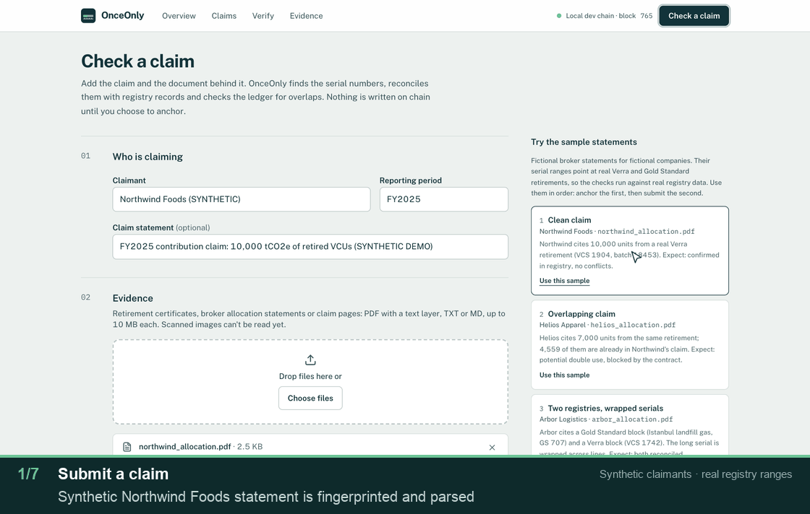
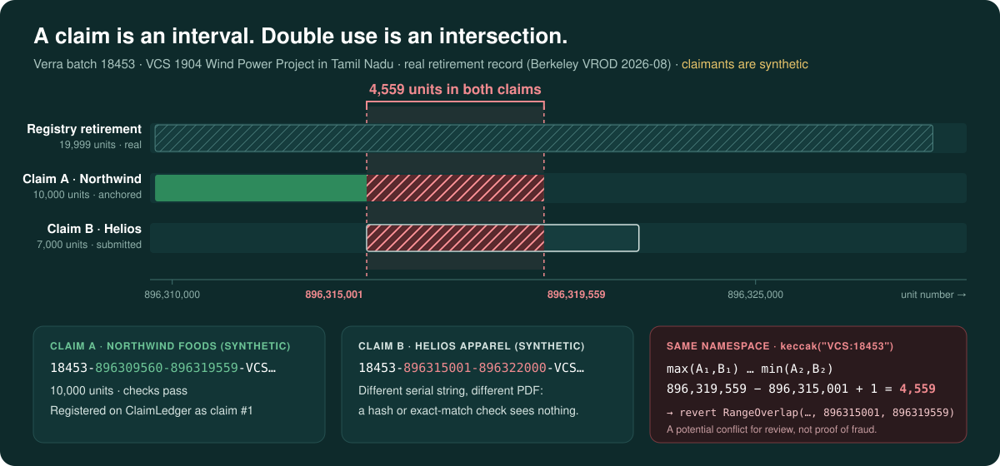
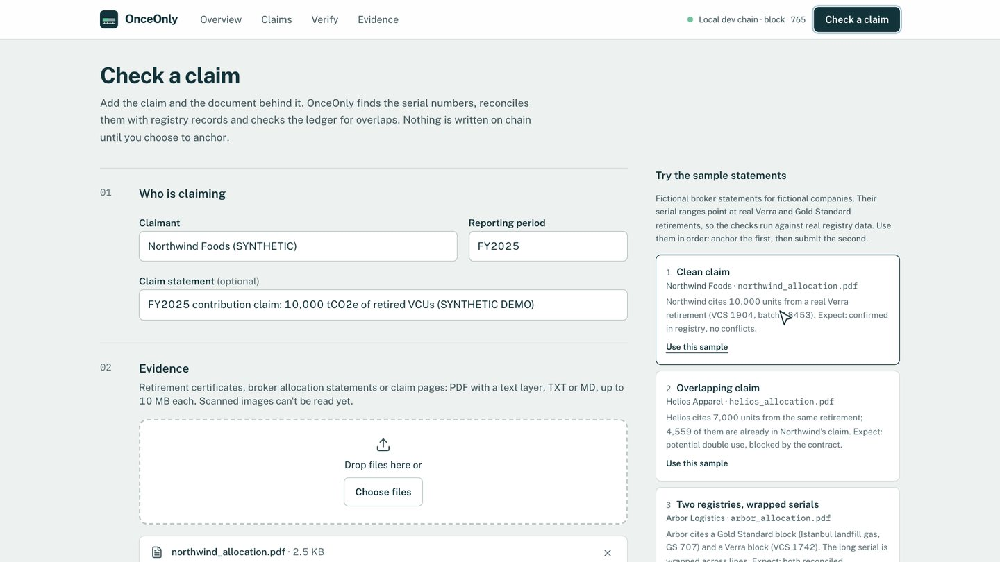
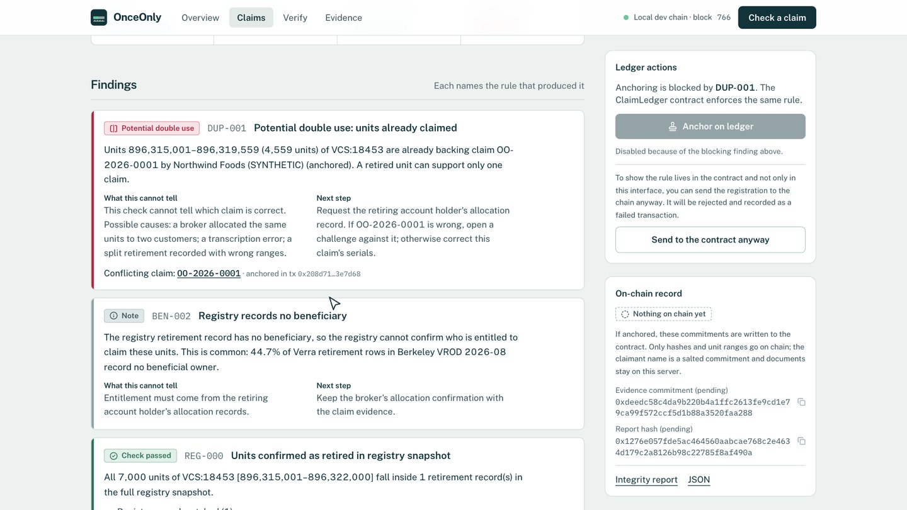
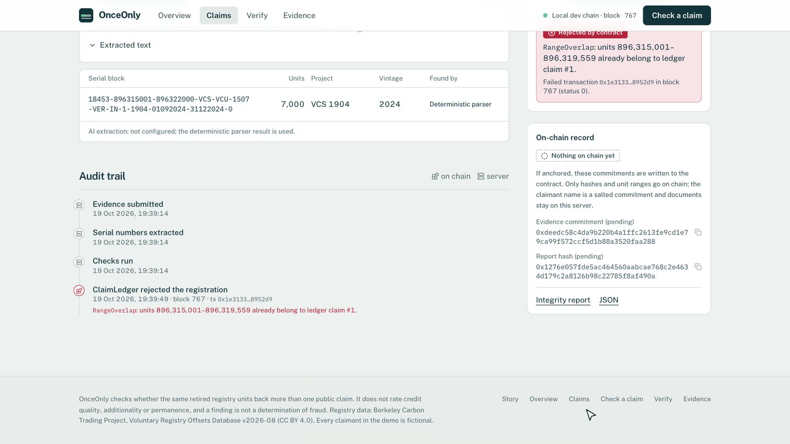
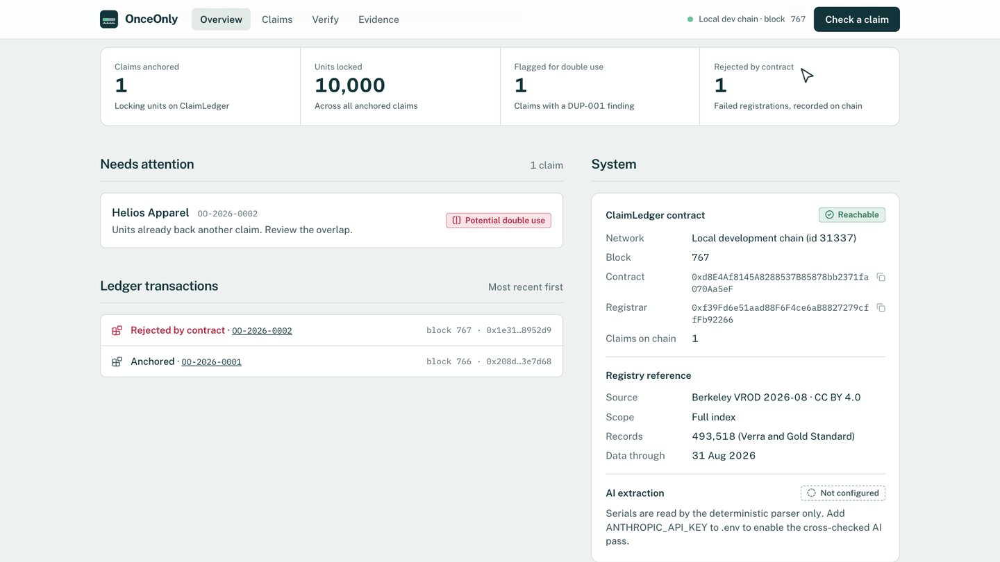
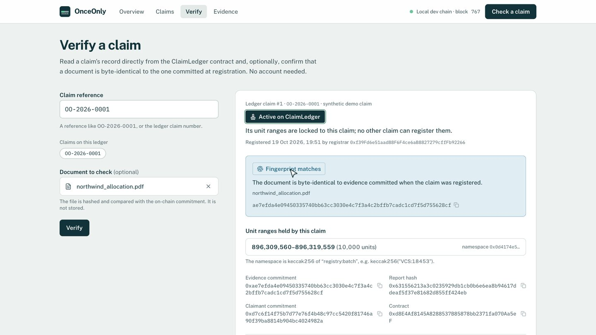
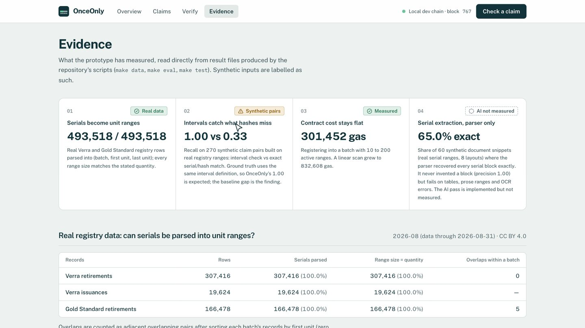
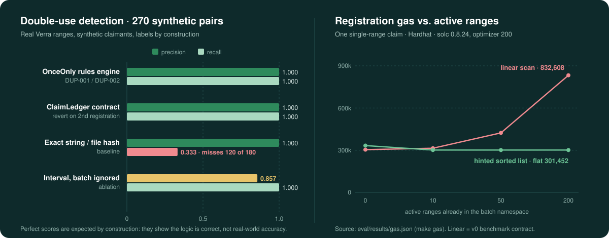

<div align="center">


# OnceOnly

### Every retired tonne, claimed once.

Registries make sure a carbon credit is **retired** only once. Nothing checks whether the same retired units then back **two companies' public climate claims**.<br>
OnceOnly reads the serial numbers behind a claim, turns them into unit intervals, finds units that are already claimed, and anchors claims on a smart contract that **refuses to register the same unit twice**.

<p>

</p>
<p>


</p>

[**Problem**](#the-problem) · [**How it works**](#how-it-works) · [**Demo**](#see-it-work) · [**Why intervals**](#why-interval-overlap-matters) · [**Architecture**](#architecture) · [**Evaluation**](#evaluation) · [**Quick start**](#quick-start) · [**Limitations**](#trust-boundaries-and-limitations)

<br>


<sub>Real Verra retirement record (Berkeley VROD 2026-08). Claimants are synthetic. Transactions run on a local Hardhat development chain.</sub>

</div>

---

## The problem

A retirement certificate says *"these units are used up."* It does not say *who may claim them*. Companies cite retired units in sustainability reports, product labels and websites, often through brokers who split one retirement across several buyers. If two claims cite the same units, each one looks valid when read alone.

That is **double use**, and today it is found, if at all, by someone reading documents side by side. Hash comparison does not help: two claims that share units usually have **different serial strings and different PDFs**.

> [!NOTE]
> OnceOnly does **not** rate credit quality, additionality or permanence. An overlap is a **potential** double use that needs review, not a finding of fraud. A matching SHA-256 proves a file is unchanged, not that its contents are true.

## How it works

| | Step | What happens |
|:-:|---|---|
| **1** | **Read the evidence** | Accepts a PDF, TXT or pasted statement. Hashes each file (SHA-256, in the browser and on the server) and extracts registry serial numbers with a deterministic parser. An optional Claude pass is cross-checked against the parser. |
| **2** | **Reconcile with the registry** | Each serial becomes an inclusive unit range in one issuance batch. It is matched against **real** registry retirement records (Berkeley VROD 2026-08, 493,518 Verra and Gold Standard rows). |
| **3** | **Check the ledger** | Compares the ranges with every active claim **in the same registry and batch**, quantifies shared units, and explains each finding with its rule ID, its uncertainty and a next step. |
| **4** | **Anchor on a smart contract** | `ClaimLedger` stores only unit ranges and hashes, and **itself rejects** any range that overlaps an active claim (`RangeOverlap`), whatever the interface does. |
| **5** | **Let anyone verify** | Claim status and evidence fingerprints are read straight from the contract, with no account needed. Anyone can open a challenge; reviewers can uphold it (releasing the units) or dismiss it. |

## See it work

<div align="center">

<br>
<sub>Frames are from the app's own recorded walkthrough (<code>make demo-record</code>), with captions added. Claimants are synthetic; registry ranges are real.</sub>
</div>

## Why interval overlap matters

A Verra or Gold Standard serial number encodes a **contiguous range of unit numbers inside one issuance batch**. So a claim is an interval, and double use is an **intersection**:

<div align="center">

</div>

The check is small and exact. Here is the off-chain rule from [`backend/app/serials.py`](backend/app/serials.py):

```python
def overlap(a: SerialBlock, b: SerialBlock) -> tuple[int, int] | None:
    """Inclusive overlap of two blocks in the same namespace, else None."""
    if a.namespace != b.namespace:
        return None
    lo, hi = max(a.unit_start, b.unit_start), min(a.unit_end, b.unit_end)
    return (lo, hi) if lo <= hi else None
```

For the demo pair: `min(896,319,559, 896,322,000) − max(896,309,560, 896,315,001) + 1 = 4,559` shared units.

**Why hashes are not enough.** Claim A and claim B cite different serial strings in different documents, so exact-string and file-hash matching see nothing in common. On the 270-pair evaluation, that baseline misses **every** partial, contained, superset or reformatted overlap (recall 0.333).

**Why the batch matters.** Unit numbers restart in every issuance batch. In the real Verra data, ignoring the batch produces **11,631** apparent overlaps between adjacent records, and **all** of them are between different batches. So both the engine and the contract key ranges by `keccak("REGISTRY:BATCH")`. A batch-blind interval check drops to precision **0.857** on the evaluation set.

## Product tour

<table>
  <tr>
    <td width="50%"><br><b>Check a claim.</b> Add a claimant and evidence, or use the labelled synthetic samples.</td>
    <td width="50%"><br><b>Claim detail.</b> Verdict, the Ruler with the exact shared range, and the contract's rejection.</td>
  </tr>
  <tr>
    <td><br><b>Findings.</b> Each rule says what it established, what it cannot tell, and what to do next.</td>
    <td><br><b>Audit trail.</b> Server events and on-chain events side by side, including the failed transaction.</td>
  </tr>
  <tr>
    <td><br><b>Overview.</b> What is anchored, what is blocked, and every transaction the contract accepted or refused.</td>
    <td><br><b>Verify.</b> Read a claim directly from the contract and check a document against its committed fingerprint.</td>
  </tr>
</table>

<details>
<summary><b>Evidence page</b>: the prototype's own measurements, rendered from result files</summary>
<br>

</details>

## Architecture

<div align="center">

</div>

**Off-chain** (explainable, replaceable): extraction, registry reconciliation, the rule findings, evidence files and a mirrored audit log.<br>
**On-chain** (authoritative, neutral): unit ranges, evidence and report hashes, a salted claimant commitment, claim status, and the non-overlap invariant.

<details>
<summary><b>Request flow</b>: <code>POST /api/claims</code> → <code>POST /api/claims/{id}/anchor</code></summary>

1. Create a draft claim; store the evidence content-addressed; compute hashes.
2. Extract serial blocks (parser, plus the AI pass if a key is configured) and cross-check them.
3. Run the rules and compute `report_hash` over the canonical findings and blocks.
4. Set the status to `checked`, or to `blocked` if any finding is blocking.
5. Anchor: on-chain `checkRange` pre-flight → `registerClaim` transaction → receipt → store the tx hash, block and on-chain claim ID.
6. If the transaction reverts (a race, or a deliberately forced attempt), decode the custom error and record a `chain_rejected` event.

More detail: [docs/10_system_architecture.md](docs/10_system_architecture.md) · [docs/12_ai_and_blockchain_design.md](docs/12_ai_and_blockchain_design.md)
</details>

### Why a blockchain?

Claims come from competitors, brokers, auditors and registries in different jurisdictions. A central database could run the same overlap check, but its operator could reorder, edit or delete claims, and everyone would have to trust it. The contract provides a neutral first-come ordering, an invariant no party can bypass (no overlapping unit ranges), append-only challenge history, and verification without an account. Only ranges (already public on registries), a salted claimant commitment and document hashes go on chain. Full reasoning and limits: [docs/06_product_thesis.md](docs/06_product_thesis.md).

## Technical highlights

- **O(1) on-chain overlap check.** `ClaimLedger` keeps the active ranges of each namespace as a sorted doubly linked list. The caller passes a predecessor hint (`hintFor`), and the contract only checks that predecessor and its successor, so registration gas is **flat at 301,452** from 10 to 200 active ranges. The linear-scan v0 reaches 832,608 at 200. Adversarial hints revert with `BadHint`; they never skip a check.
- **Precise custom errors.** `RangeOverlap(ns, existingClaimId, overlapStart, overlapEnd)` returns the exact shared interval. The backend decodes it into a human-readable audit event.
- **Batch-aware namespaces.** `keccak("REGISTRY:BATCH")` is used both on-chain and off-chain, justified by the real-data audit above.
- **Real registry reconciliation.** All 493,518 VROD serials parse into quantity-consistent unit ranges. Lookups distinguish *confirmed*, *not found* and *cannot check*, and never report a pass they cannot support.
- **Explainable findings.** Rule families `SER`, `REG`, `BEN`, `DUP`, `AGG`, `EVD` and `EXT` each return a severity, the evidence, what the rule *cannot* tell, and a next action.
- **Privacy by construction.** Evidence files stay on the server under `var/evidence/<sha256>`. The claimant name goes on chain only as a salted commitment.
- **Deterministic demo.** `make reset` → `make seed` → `make demo-check` reproduces the same state fingerprint across runs.

## Technology stack

| Layer | Technology |
|---|---|
| Smart contract | Solidity 0.8.24 (optimizer 200), Hardhat 2, ethers; `ClaimLedger.sol` plus the `ClaimLedgerLinear.sol` benchmark |
| Backend | Python 3.12, FastAPI, Pydantic 2, web3.py 7, pypdf, SQLite |
| AI extraction (optional) | Anthropic SDK with structured output, validated by Pydantic and re-parsed by the deterministic parser |
| Frontend | React 19, TypeScript, Vite, Tailwind CSS 4 |
| Data | Berkeley Carbon Trading Project, *Voluntary Registry Offsets Database* v2026-08 (Verra and Gold Standard) |
| QA | Hardhat tests, pytest, Playwright with axe-core, an end-to-end API smoke test |
| Packaging | Single Docker image (private Hardhat chain, seeded demo and API serving the built UI) |

## Evaluation

All numbers below are produced by scripts in this repository and stored in [`eval/results/`](eval/results/).

<div align="center">

</div>

| Result (from `eval/results/`) | Value |
|---|---|
| Registry serials parsed into unit ranges | 493,518 / 493,518 (100%), all quantity-consistent |
| Overlapping Verra retirements within a batch | 0 of 307,416 |
| Apparent overlaps if the batch is ignored | 11,631 adjacent pairs, all between different batches (collisions of the wrong key, not overlaps), so ranges are keyed by registry **and** batch |
| Double-use detection, 270 labelled pairs (OnceOnly / contract) | precision 1.000, recall 1.000 (expected by construction; see below) |
| Same set, exact serial-string or document-hash baseline | recall 0.333 (misses every partial, contained, superset or reformatted overlap) |
| Same set, interval overlap ignoring the batch | precision 0.857 (30 false positives from the same unit numbers in a different batch) |
| On-chain registration gas, batch with 10 → 200 active claims | flat 301,452 (sorted interval list with O(1) hinted insert); linear v0 grows to 832,608 |
| Deterministic serial extraction, 60 synthetic snippets (real serial ranges, 8 layouts) | 65% of snippets had every serial block recovered exactly; block precision 1.00 (never invents a block), recall 0.69. It fails on tables, prose ranges and OCR errors. The optional AI extractor targets those, but it is **not measured** |

<details>
<summary><b>Per-case breakdown</b> (270 pairs, 30 per case)</summary>

| Case type | Truth | OnceOnly | Contract | Hash baseline | Batch-blind |
|---|---|:-:|:-:|:-:|:-:|
| Same serial, same units | double use | 30/30 | 30/30 | 30/30 | 30/30 |
| Same units, serial reformatted | double use | 30/30 | 30/30 | 0/30 | 30/30 |
| Partial overlap, different serial strings | double use | 30/30 | 30/30 | 0/30 | 30/30 |
| New range inside an existing claim | double use | 30/30 | 30/30 | 0/30 | 30/30 |
| New range contains an existing claim | double use | 30/30 | 30/30 | 0/30 | 30/30 |
| Same evidence document resubmitted | double use | 30/30 | 30/30 | 30/30 | 30/30 |
| Adjacent ranges, no shared unit | not double use | 30/30 | 30/30 | 30/30 | 30/30 |
| Same batch, disjoint ranges | not double use | 30/30 | 30/30 | 30/30 | 30/30 |
| Same unit numbers in a different batch | not double use | 30/30 | 30/30 | 30/30 | 0/30 |

Parser by layout: canonical 8/8, wrapped 8/8, spaced dashes 8/8, en dashes 8/8, two blocks 7/7, table columns 0/7, prose range 0/7, OCR letter-O 0/7.
</details>

> [!IMPORTANT]
> **How to read these numbers.** The labelled pairs are synthetic claims on real registry ranges, and the ground truth uses the same interval definition as the engine. The perfect scores show that the implementation is correct and that simpler methods miss cases. **They are not real-world accuracy**, and they say nothing about how common double use actually is. Gas is measured on a local Hardhat chain. Method and caveats: [docs/14_evaluation_plan.md](docs/14_evaluation_plan.md).

## Quick start

**Requirements:** Python 3.12, Node 20+ (tested on Node 26), `make`. Docker is optional.

```bash
make setup
```

`make setup` creates `.venv`, installs the Python, contract and web dependencies, copies `.env.example` to `.env` if needed, and compiles the contract. The `.env` defaults use the **publicly known Hardhat development keys**, which only work on the local chain. Never put a real or funded key there.

Then, in three terminals:

```bash
make chain
```

```bash
make deploy && make api
```

```bash
make web
```

Open http://127.0.0.1:5173 for the story, or http://127.0.0.1:5173/overview for the application. On **Check a claim**, use the sample statements in order: clean claim → overlapping claim (blocked; try *Send to the contract anyway*) → two registries → mistyped serial → claim without serials. To preload the whole story through the API, run:

```bash
make seed
```

The repo ships a curated real-data subset (`data/reference/demo_subset.csv.gz`, 38k rows) that covers every demo scenario. For the full 493k-row index and the registry audit, run the command below. It **downloads about 67 MB** from Berkeley and builds `data/reference/registry_full.sqlite`.

```bash
make data
```

<details>
<summary><b>Reset to the exact demo story</b></summary>

Keep `make chain` running. Then:

1. Clear the app database and evidence store (`var/onceonly.sqlite`, `var/evidence/`), and deploy a fresh ClaimLedger:

   ```bash
   make reset
   ```

2. Restart the API (stop `make api` and start it again) so it uses the new contract.
3. Replay the five-claim story through the real API:

   ```bash
   make seed
   ```

4. Print the demo's state fingerprint:

   ```bash
   make demo-check
   ```

The fingerprint covers claim references, statuses, unit counts, finding rule IDs, evidence hashes, on-chain claim numbers and contract rejections; block numbers and timestamps are excluded. Three consecutive reset-and-seed runs produced the identical fingerprint `c544f589…6483b`.
</details>

<details>
<summary><b>Run it as one container</b></summary>

A single Docker image bundles a private Hardhat chain (loopback only), the contract deployment, the seeded demo story and the API serving the built UI. It starts in **public demo mode**: ledger writes (anchor, challenge, resolve, withdraw) return 403 with an explanation, and claim checks are rate-limited (10 per IP per 10 minutes) and capped (200 per instance). State is ephemeral; every start reseeds the same story.

```bash
make docker-build
```

```bash
make docker-run
```

Open http://127.0.0.1:7860. The container prints the demo fingerprint at boot. Details, environment variables and a prepared (not deployed) Render blueprint: [docs/submission/08_deployment_runbook.md](docs/submission/08_deployment_runbook.md).
</details>

<details>
<summary><b>Optional AI extraction</b></summary>

Put your own key in `.env` as `ANTHROPIC_API_KEY=...` (never commit it; `.env` is gitignored). Without a key, the deterministic parser is used and the UI says so.
</details>

### Tests and evaluation

```bash
make test
```

```bash
make eval
```

```bash
make e2e
```

Frontend checks run against the live, seeded stack. Playwright drives your installed Chrome, so no browser download is needed:

```bash
cd frontend && npx playwright test
```

| Command | What it does |
|---|---|
| `make test` | 24 contract tests (Hardhat) and 24 backend tests (pytest); leaves the working tree clean |
| `make eval` | Runs the 270-pair detection and 60-snippet extraction evaluation; writes `eval/results/latest.{json,md}` |
| `make gas` | Regenerates `eval/results/gas.json` |
| `make e2e` | A 13-step walkthrough against the running stack. It needs a fresh ledger, so run it after `make reset` and an API restart, before `make seed` |
| `npx playwright test` | 30 tests: 18 interaction tests, 4 keyboard-only walkthroughs, a link crawl and 7 axe-core WCAG A/AA checks. They expect the seeded demo story |
| `make demo-validate` / `make demo-record` | Replays the demo film's steps and checks outcomes, or records the reference film to `exports/` (fresh ledger, `make web` running) |

Design research, critique, polish log and QA reports are in [docs/design/](docs/design/).

## Project structure

```text
ClimateChain/
├── contracts/            Solidity + Hardhat
│   ├── contracts/        ClaimLedger.sol · benchmark/ClaimLedgerLinear.sol (v0)
│   ├── scripts/deploy.js
│   └── test/             24 contract tests, including the gas benchmark
├── backend/              FastAPI service
│   ├── app/              serials · extraction · reference · rules · chain · service · main
│   ├── scripts/          build_reference · make_demo_docs · seed_demo · demo_fingerprint
│   └── tests/            24 pytest tests
├── frontend/             React + Vite UI
│   ├── src/pages/        Landing · Overview · NewClaim · ClaimPage · Claims · Verify · Evidence
│   ├── src/components/   Ruler · SerialAnatomy · Shell · …
│   └── qa/               Playwright tests, screenshot capture, demo recorder
├── eval/                 run_eval.py · e2e_smoke.py · results/
├── data/                 demo documents (synthetic) · registry reference subset (real) · LICENSE
├── docs/                 design docs 00–16 · design/ · submission/ · assets/ (README visuals)
├── deploy/ · Dockerfile · render.yaml   single-container demo (Render blueprint prepared, not deployed)
└── Makefile              every command in this README
```

## Trust boundaries and limitations

| | Status |
|---|---|
| Registry retirement and issuance records | **Real**, public: Berkeley Carbon Trading Project, *Voluntary Registry Offsets Database* v2026-08, released by Berkeley under CC BY 4.0 (data through 2026-08-31). The underlying Verra and Gold Standard rights are unverified; see [Licence](#licence) |
| Claimants, broker statements, claims | **Synthetic**, fictional names, labelled "SYNTHETIC" everywhere |
| Blockchain transactions | Real transactions on a **local Hardhat development chain** (chain ID 31337), not a public network |
| Audit history | On-chain events are authoritative; the SQLite `events` table is an off-chain mirror for display |

**Known limitations**

- Local development chain only; there is no public testnet deployment yet.
- No live registry integration. Reconciliation uses a static snapshot that ends on 2026-08-31, so later retirements show as "not found".
- No authentication or multi-tenancy. The backend holds one registrar key, so the registrar is a trusted operator.
- AI extraction is implemented but not yet evaluated. The deterministic parser misses table, prose-range and OCR-damaged layouts.
- OnceOnly detects shared units. It cannot say which claim is legitimate; that takes broker records and a human reviewer.
- This is a hackathon prototype. It has not been security-audited and is not production-ready.

## Future improvements

Grounded in the project backlog ([docs/16_task_backlog.md](docs/16_task_backlog.md)):

- **Measure AI extraction** on the 60-snippet set with a real API key, including cost and latency.
- **Public testnet deployment** (for example Sepolia) with explorer links in the UI.
- **EIP-712 claimant signatures**, so the claimant, not the platform, authorizes registration.
- **Merkle-root evidence commitments**, so each document in a multi-document claim can be verified on its own.
- **Registry updates beyond VROD 2026-08**, and evaluation of beneficiary matching on real pairs.

## Documentation

[`docs/00_mission_status.md`](docs/00_mission_status.md) is the project status. Hackathon submission material (Devpost copy, demo script, judge Q&A, deployment and QA reports) is in [docs/submission/](docs/submission/). Docs 01–16 cover requirements, judging strategy, competitive landscape, sources, idea selection, thesis, product requirements, architecture, data model, AI/blockchain design, security, evaluation and backlog.

## Licence

The source code is released under the [MIT License](LICENSE). The contents of `data/` (registry records and the demo documents that quote them) are **not** covered by it; their rights are separate. Berkeley releases the registry database under CC BY 4.0, but the committed registry rows originate from the Verra and Gold Standard registries, whose terms we could not verify permit redistribution. They are included for demonstration and attributed, and will be removed on request of a rights holder. See [data/LICENSE](data/LICENSE).

## Data attribution

Registry data © the respective registries, compiled by Berkeley Carbon Trading Project: Quartson, P., Haya, B.K., Bernard, T., Abayo, A., Rong, X., So, I.S., Elias, M. (2026). *Voluntary Registry Offsets Database v2026-08*, UC Berkeley. Licensed CC BY 4.0.

<div align="center">
<br>
<sub>Built for the IEEE ClimateChain Global Hackathon 2026 by <a href="https://github.com/Sidd927">Siddhant Patil</a>.</sub>
</div>
