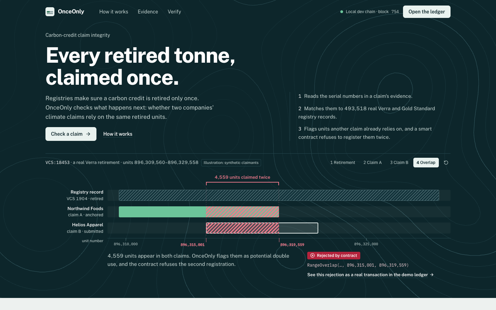
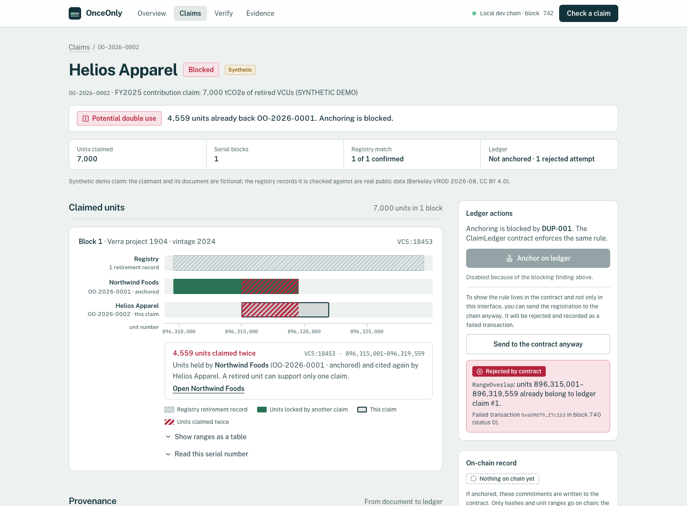

# OnceOnly — every retired tonne, claimed once

**Track: Carbon Markets & Emissions Transparency** (IEEE ClimateChain Global Hackathon 2026)

Carbon registries make sure a credit is retired only once. What they don't cover is what happens next: whether the *same retired units* end up behind two companies' public climate claims ("double use"). OnceOnly closes that gap:

1. **Reads the evidence.** It extracts registry serial numbers from retirement certificates and claim documents using a deterministic parser, plus an optional AI pass that is cross-checked against the parser.
2. **Reconciles with the registry.** Each serial becomes a unit range in one issuance batch and is matched against **real** registry retirement records (Berkeley VROD 2026-08: 493,518 Verra and Gold Standard rows).
3. **Checks the ledger.** It compares the ranges with every active claim in the same batch and explains any shared units.
4. **Anchors on a smart contract.** `ClaimLedger` stores only unit ranges and hashes, and **itself rejects** any range that overlaps an active claim (`RangeOverlap`).
5. **Lets anyone verify.** Claim status and evidence fingerprints are read straight from the contract. Anyone can open a challenge; reviewers can uphold one (releasing the units) or dismiss it.





## What is real and what is synthetic

| | |
|---|---|
| Registry retirement and issuance records | **Real**, public: Berkeley Carbon Trading Project, *Voluntary Registry Offsets Database* v2026-08, CC BY 4.0 (data through 2026-08-31) |
| Claimants, broker statements, claims | **Synthetic**, fictional names, labelled "SYNTHETIC" everywhere |
| Blockchain transactions | Real transactions on a **local Hardhat development chain** (chain id 31337), not a public network |

OnceOnly does **not** rate credit quality, additionality or permanence. A conflict is a *potential* double use that needs review, not a finding of fraud. A matching hash proves a document is unchanged, not that it is true.

## Quick start

Requirements: Python 3.12, Node 20+ (tested on Node 26), make.

```bash
make setup
```

Then, in three terminals:

```bash
make chain
```

```bash
make deploy && make api
```

```bash
make web
```

Open http://127.0.0.1:5173 for the story, or http://127.0.0.1:5173/overview for the application. On **Check a claim**, use the sample statements in order: clean claim → overlapping claim (blocked; try *Send to the contract anyway*) → two registries → mistyped serial → claim without serials. To preload that whole story through the API, run:

```bash
make seed
```

The repo ships a curated real-data subset (`data/reference/demo_subset.csv.gz`, 38k rows) that covers every demo scenario. For the full 493k-row index and the registry audit, run:

```bash
make data
```

### Reset to the exact demo story

Keep `make chain` running. Then:

1. Clear the app database and evidence store, and deploy a fresh ClaimLedger:

   ```bash
   make reset
   ```

2. Restart the API (stop `make api` and start it again) so it uses the new contract.
3. Replay the five-claim story through the real API:

   ```bash
   make seed
   ```

4. Print the demo's state fingerprint:

   ```bash
   make demo-check
   ```

The fingerprint covers claim references, statuses, unit counts, finding rule IDs, evidence hashes, on-chain claim numbers and contract rejections; block numbers and timestamps are excluded. Three consecutive reset-and-seed runs produced the identical fingerprint `c544f589…6483b`.

### Run it as one container

A single Docker image bundles a private Hardhat chain (loopback only), the contract deployment, the seeded demo story and the API serving the built UI. It starts in **public demo mode**: ledger writes (anchor, challenge, resolve, withdraw) return 403 with an explanation, and claim checks are rate-limited (10 per IP per 10 minutes) and capped (200 per instance). State is ephemeral; every start reseeds the same story.

```bash
make docker-build
```

```bash
make docker-run
```

Open http://127.0.0.1:7860. The container prints the demo fingerprint at boot. Details, environment variables and a prepared (not deployed) Render blueprint: [docs/submission/08_deployment_runbook.md](docs/submission/08_deployment_runbook.md).

### Optional AI extraction

Put your own key in `.env` as `ANTHROPIC_API_KEY=...` (never commit it). Without a key, the deterministic parser is used and the UI says so.

## Tests and evaluation

```bash
make test
```

```bash
make eval
```

```bash
make e2e
```

Frontend checks run against the live, seeded stack (Playwright drives your installed Chrome, so no browser download is needed):

```bash
cd frontend && npx playwright test
```

That is 30 tests: 18 interaction tests, 4 keyboard-only walkthroughs, a link crawl and 7 axe-core WCAG A/AA checks. They expect the seeded demo story. Design research, critique, polish log and QA reports are in [docs/design/](docs/design/).

`make test` runs 24 contract and 24 backend tests, and leaves the working tree clean. `make gas` regenerates `eval/results/gas.json`. `make eval` writes `eval/results/latest.md`. `make e2e` runs a 13-step walkthrough against the running stack; it needs a fresh ledger, so run it after `make reset` and an API restart, before `make seed`.

| Result (from `eval/results/`) | Value |
|---|---|
| Registry serials parsed into unit ranges | 493,518 / 493,518 (100%), all quantity-consistent |
| Overlapping Verra retirements within a batch | 0 of 307,416 |
| Apparent overlaps if the batch is ignored | 11,631 adjacent pairs, all between different batches (collisions of the wrong key, not overlaps), so ranges are keyed by registry **and** batch |
| Double-use detection, 270 labelled pairs (OnceOnly / contract) | precision 1.000, recall 1.000 (expected by construction; see below) |
| Same set, exact serial-string or document-hash baseline | recall 0.333 (misses every partial, contained, superset or reformatted overlap) |
| On-chain registration gas, batch with 10 → 200 active claims | flat 301,452 (sorted interval list with O(1) hinted insert); linear v0 grows to 832,608 |
| Deterministic serial extraction, 60 synthetic snippets (real serial ranges, 8 layouts) | 65% of snippets had every serial block recovered exactly; block precision 1.00 (never invents a block), recall 0.69. It fails on tables, prose ranges and OCR errors. The optional AI extractor targets those, but it is **not measured** |

The labelled pairs are synthetic claims on real registry ranges, and ground truth uses the same interval definition as the engine. These numbers show the implementation is correct and that simpler methods miss cases. They are not real-world accuracy. Details: [docs/14_evaluation_plan.md](docs/14_evaluation_plan.md).

## Architecture

```
React/Vite UI ──► FastAPI ──► rules engine ──► registry reference (SQLite, VROD)
                     │            ▲
                     │            └── extraction: regex parser ∥ optional Claude (structured output)
                     └──► web3.py ──► ClaimLedger.sol (Hardhat local chain)
```

See [docs/10_system_architecture.md](docs/10_system_architecture.md) and [docs/12_ai_and_blockchain_design.md](docs/12_ai_and_blockchain_design.md).

## Why a blockchain?

Claims come from competitors, brokers, auditors and registries in different jurisdictions. A central database could run the same overlap check, but its operator could reorder, edit or delete claims, and everyone would have to trust it. The contract provides a neutral first-come ordering, an invariant no party can bypass (no overlapping unit ranges), append-only challenge history, and verification without an account. Only ranges (already public on registries), a salted claimant commitment and document hashes go on chain. Full reasoning and limits: [docs/06_product_thesis.md](docs/06_product_thesis.md).

## Known limitations

- Local development chain only; no public testnet deployment yet.
- No authentication or multi-tenancy; one registrar key held by the backend.
- AI extraction is implemented but not yet evaluated.
- Registry snapshot ends 2026-08-31; later retirements show as "not found".

## Documentation

`docs/00_mission_status.md` is the project status. Hackathon submission material (Devpost copy, demo script, judge Q&A, deployment and QA reports) is in [docs/submission/](docs/submission/). Docs 01–16 cover requirements, judging strategy, competitive landscape, sources, idea selection, thesis, product requirements, architecture, data model, AI/blockchain design, security, evaluation and backlog.

## Licence

The source code is released under the [MIT License](LICENSE). The contents of `data/` (registry records and the demo documents that quote them) are **not** covered by it; they keep the dataset's CC BY 4.0 terms. See [data/LICENSE](data/LICENSE).

## Data attribution

Registry data © the respective registries, compiled by Berkeley Carbon Trading Project: Quartson, P., Haya, B.K., Bernard, T., Abayo, A., Rong, X., So, I.S., Elias, M. (2026). *Voluntary Registry Offsets Database v2026-08*, UC Berkeley. Licensed CC BY 4.0.
