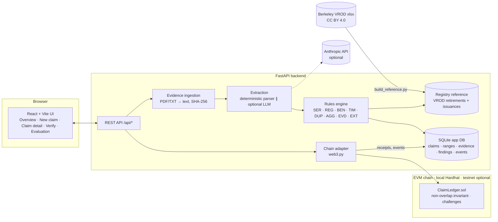

# 10 — System Architecture

## Components

| Component | Responsibility | Tech |
|---|---|---|
| **Data ingestion** | Accept PDF/TXT/pasted text; extract text (pypdf); compute SHA-256 of raw bytes; store the file outside the web root (not served publicly) | FastAPI, pypdf |
| **Serial parser** | Registry-specific regexes → `SerialBlock(registry, batch_id, start, end, project_id, vintage…)`; tolerant of whitespace and line breaks | Python, deterministic |
| **AI extraction** | LLM returns JSON (claimant, beneficiary, serials, quantities, project, vintage, retirement date); pydantic-validated; each serial re-parsed by the deterministic parser | Anthropic SDK (optional) |
| **Rules engine** | Pure functions → `Finding(rule_id, severity, title, explanation, evidence, uncertainty, next_action)` | Python |
| **Registry reference** | SQLite tables of retirement and issuance ranges, indexed by `(registry, batch_id, start)` | Built from VROD |
| **Duplicate detection** | Interval overlap against the active-claims index (off-chain) and `checkRange` (on-chain pre-flight); duplicate document hash; duplicate claim ref | SQL + contract |
| **Evidence storage** | `var/evidence/<sha256>`; content-addressed; never on chain | filesystem |
| **Hashing** | SHA-256 for documents; keccak256 for on-chain commitments (claimant commitment = keccak(salt ‖ normalized name)) | hashlib, eth-utils |
| **Blockchain anchoring** | `registerClaim(ref, ranges[], claimantCommitment, evidenceHash, reportHash)`; challenges; resolution | Solidity 0.8.24, Hardhat |
| **Audit history** | Off-chain `events` table mirrors every state change, with tx hashes; on-chain events are authoritative | SQLite + logs |
| **Frontend** | Guided wizard, unit strip, findings, verify, evaluation | React, TS, Tailwind |

## Request flow: `POST /api/claims` → `POST /api/claims/{id}/anchor`

1. Create a draft claim; store evidence; compute hashes.
2. Extract (parser, plus LLM if enabled) → blocks; cross-check.
3. Run rules → findings; compute `report_hash = sha256(canonical JSON of findings + blocks)`.
4. Status `checked`, or `blocked` if any blocking finding.
5. Anchor: on-chain `checkRange` pre-flight → `registerClaim` tx → wait for receipt → store tx hash, block, and on-chain claim ID → status `anchored`.
6. If the tx reverts (race, or forced attempt), decode the custom error → store a `chain_rejected` event.

## Failure modes and recovery

| Failure | Behavior |
|---|---|
| LLM unavailable, no key, or invalid JSON | Fall back to the deterministic parser; finding EXT-000 (info): "AI extraction unavailable" |
| LLM and parser disagree | EXT-001 review; the parser result is used for anchoring (deterministic, auditable) |
| Chain node down | Anchor endpoint returns 503 with a clear message; claim stays `checked`; retry later |
| Contract not deployed or address mismatch | `/api/health` shows `chain: unavailable`; UI banner |
| Registry reference missing | Health shows `reference: missing`; REG rules return "cannot check" (never "pass") |
| Off-chain index diverges from chain | `make reconcile` rebuilds anchored state from contract events (chain is the source of truth) |
| PDF has no text layer (scanned) | EVD-002: "no machine-readable text"; paste text manually (OCR out of scope) |

## Data provenance labels

| Data | Status |
|---|---|
| Registry retirements/issuances | **Real**, public, Berkeley VROD v2026-08 (data through 2026-08-31), CC BY 4.0 |
| Claimants, claims, certificates, brokers | **Synthetic**, fictional names, labeled SYNTHETIC |
| Chain transactions | **Real transactions on a local development chain** (Hardhat, chainId 31337), not a public network |
| Evaluation sets | Real-data audit (real) + labeled synthetic claim set (synthetic, seeded) |
